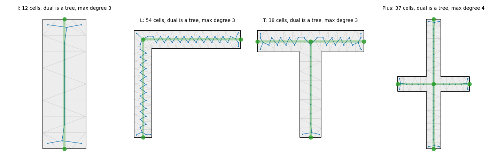

# Geometric deep learning for the graph-based midcurve: research report and plan

## Status

- Done: first version; second pass steps 1 to 5 (read, sceptical review with overclaims fixed in place, section 12
  options, literature searches with section 5 novelty table and section 11 updated, tidy of section 10 and header).
- Remaining: nothing planned. Open items are listed under "Still open" in section 11. Nothing was run; no code touched.
- Last update: 2026-11-03, second pass.

Date: 2026-11-03. Scope: `src/geometry_based/` and `publications/Midcurve_LaTeX/`. No repo code was changed.
Files added or touched: this report, `images/gdl_dual_complex.png`, and a one-line ledger entry in
`06_EXECUTION_PLAN.md`.

## 1. Summary

**Overall verdict: are GDL enhancements possible?** Yes, but narrowly, and the gain is unproven. Of the eleven options
reviewed in section 12, one is a cheap control that is not GDL (continuous rotation augmentation) and should be run
first. One GDL option, EquiCollapse, is a credible research contribution because it is the only one with a by-construction
argument for variable node count and for topology. Two (the plain equivariant decoder with query slots, and
frame averaging as a main method) are expected to fail or add little on this benchmark. Five (steerable networks, graph
diffusion, autoregressive generation, gauge convolution, boundary deformation) are poor fits or too risky now. Cell
networks and link prediction are parts to add later, for holes. The data are procedural and unlimited and the
classical Voronoi baseline is already exactly rotation-equivariant, so the honest case for GDL rests on noise,
non-orthogonal shapes, holes and small-data regimes, none of which has been measured. No trained result exists for any GDL option.

1. **The Gemini notes describe the legacy model, not the current one.** The "topology is the bottleneck" claim came
   from the old graph transformer. The current `set_transformer` learns the node set and derives edges with an
   inside-polygon MST, which reproduces the ground-truth edges on all real and synthetic shapes when given the
   true nodes (P1). For hole-free shapes, edges are not the bottleneck. Cycles (holes) are still out of reach for an MST.
2. **The current model is not a GDL model in any meaningful sense.** It has no built-in symmetry; it only sees
   augmentation by 90-degree rotations, reflections, listing shifts and inserted collinear vertices.
   A 5-degree rotation drops `ok_025w` from 0.873 to 0.363, and 15 degrees drops it to 0.007 (section 3).
3. **The obvious GDL upgrade, which is what Gemini suggests, fails on every real shape.** A decoder whose per-slot
   outputs are E(2)-equivariant, with learned slot embeddings, cannot output the midcurve of I, L, T or Plus, because
   all four are symmetric. This follows from a short proof (which assumes slot-wise equivariance, see section 4) and
   was confirmed numerically on one overfitted network per shape.
4. **Proposed contribution: EquiCollapse (working title).** Replace "generate a graph" with "learn a quotient of a
   graph built from the input". Build the interior Delaunay cell complex of the polygon, run an E(2)-equivariant network
   on its dual graph, mark the key cells, and contract. Node count is variable by construction. The output has the
   same abstract-graph homotopy type as the shape for any network weights, provided the Delaunay complex conforms to
   the polygon (checked, not guaranteed). This is the only option here with a by-construction argument for holes;
   it has not been tested on any hole data. Output slots are anchored to input cells, which avoids the collapse in item 3 (section 5).
5. **The representation passes its no-learning check; the network is unproven.** A decoder given ground-truth labels
   reproduced the graphs exactly on 404 of 404 samples. (Written before training. Trained results: `RESULTS_gdl.md`.)
6. **A bug was found in the existing ground truth.** About 10% of synthetic samples contain a spurious node in the
   middle of a straight arm, at a position that cannot be inferred from the profile. All synthetic graph numbers in
   `RESULTS_graph.md` are affected, and its "model or representation limit" reading of the `k_exact` plateau is
   unsupported (section 3.3). Fix this first.
7. **The win is not guaranteed.** The classical Voronoi baseline is already exactly rotation-equivariant and strong on
   clean shapes (`ok_025w` 0.862 on corrected labels). EquiCollapse has to earn its place on noise, non-orthogonal
   shapes, holes and small training sets. Section 7 states what would falsify the claim.

## 2. GDL applied to this problem

Bronstein, Bruna, Cohen and Velickovic (2021) describe architectures by a domain, a symmetry group, equivariant layers,
local pooling and invariant readout. The useful question is which symmetries the midcurve operator M actually has.

| Symmetry | Is M equivariant? | Note |
|---|---|---|
| Vertex start and direction of listing (dihedral) | Yes | The polygon is a cycle, not a set, so the group is not full S_N |
| Translation, rotation, reflection (E(2)) | Yes | M(gP) = g M(P) |
| Uniform scale (giving Sim(2)) | Yes | Absolute scale carries no information |
| Output node labels (S_K) | Yes | The output is a set of nodes plus a graph on them |
| Inserting a vertex on a straight wall | Yes | Not a group action: the operation has no inverse on a general polygon. GDL's group framing does not cover it directly |
| Anisotropic stretch (affine) | **No** | The medial axis is not affine-equivariant, so this must not be built in |

Mapping the 5G framing to the repo:

| GDL domain | MidcurveNN |
|---|---|
| Grids | Phase I image models (translation only) |
| Groups | E(2) on coordinates (missing today) |
| Graphs | Ring graph (legacy); fully connected attention (current) |
| Geodesics | Interior distance. Opposite walls are close through the interior, while the boundary distance between them is large |
| Gauges | Local wall frames (tangent, inward normal) and the choice of boundary orientation |

The domain is the key point. The ring graph is the wrong one because the informative neighbour of a wall is the
opposite wall. Global attention works around this by connecting everything, with no geometry. The correct domain is the
polygon's **interior**.

Classical theory supports this choice:
- Lieutier: a bounded open set has the same homotopy type as its medial axis. The right output topology is therefore
  known from the input before any learning.
- The dual graph of a triangulated simple polygon is a tree. For a region with h holes triangulated with all vertices
  on the boundary rings, the dual graph's cycle rank is h. Proof by Euler characteristic: V - E + F = 1 - h, with
  E = E_b + E_i and E_b = V (each boundary ring has as many edges as vertices), so F - E_i = 1 - h and the cycle rank
  E_i - F + 1 equals h. (The first version argued this by "a dual cycle must enclose a hole vertex"; the Euler count
  is the cleaner statement and was checked by hand in the second pass.) Caveat: it needs the triangulation to cover
  exactly the polygon. A Delaunay triangulation of boundary samples does so only when the boundary edges are Delaunay
  edges (conformity), which is checked numerically on the test shapes but not guaranteed in general.
- The chordal axis transform (Prasad 1997, already in `references.bib`) is a rule-based skeleton on this same structure.
- For a thin, hole-free, tree-like shape the boundary is a walk around its midcurve that covers each edge twice, so
  the midcurve is informally a **quotient** of the shape (gluing opposite walls). This is an intuition, not a theorem
  used below; with holes the boundary has several rings and the picture needs care.
- The homotopy statement is about the abstract graph. Drawn with straight edges between predicted node positions,
  the output can still cross itself or leave the polygon; the guarantee does not cover geometry.

The variable-size question is answered by contraction: **the output size is whatever the key-cell contraction
yields, with no target node count and no matching.**

## 3. What the current model actually does (measured)

Read-only checks on existing checkpoints, using seed 2 for the 1000-sample test set. No model was trained for sections 3 and 4.

### 3.1 Symmetry defects

`set_transformer__iid__e100`, 300 samples with Np <= 20:

| Transform | k_exact | H <= 0.25w | ok_025w | Median H/w |
|---|---|---|---|---|
| None | 0.887 | 0.977 | 0.873 | 0.020 |
| Rotate 90 | 0.883 | 0.967 | 0.863 | 0.020 |
| Rotate 5 | 0.867 | 0.373 | 0.363 | 0.291 |
| Rotate 15 | 0.817 | 0.007 | 0.007 | 0.527 |
| Rotate 30 | 0.523 | 0.000 | 0.000 | 0.849 |
| Rotate 45 | 0.253 | 0.000 | 0.000 | 1.275 |
| Scale x10 plus translate | 0.887 | 0.977 | 0.873 | 0.020 |
| Reverse plus cyclic shift | 0.893 | 0.983 | 0.883 | 0.020 |
| Subdivide every wall once | 0.897 | 0.983 | 0.887 | 0.033 |

- Real shapes: all four pass at 0 degrees and all four fail at 15 degrees (H/w 0.38 to 0.55).
- Classical on 150 samples: `ok_025w` 0.807 at both 0 and 30 degrees.
- Scale, translation, listing order and subdivision are handled, through normalisation and augmentation.
- `geom.normalize` uses the bounding box, which itself changes under rotation.

**Fairness caveat:** the model was trained with 90-degree rotations only, so this result is expected. Continuous
rotation augmentation is the cheap fix and must be a named baseline. Beating an unaugmented model at 30 degrees would
not be a publishable result.

### 3.2 Node-count failures

- Errors are mostly one missing node: `k_err` -1 in 63 samples, +1 in 30, of 95 wrong.
- Of 72 ground-truth nodes with no prediction within 0.5w, 68 have degree 2, 4 are leaves and **0 are junctions**.
  Junctions and degree-4 centres are not what fails.
- Joint outcome on the first 400 samples: both right 0.770, only network 0.115, only classical 0.040, neither 0.075.

### 3.3 Label bug in the synthetic generator

Plotting the misses showed that many are not bends: they are nodes in the middle of a straight arm, including K=3
"straight strips" whose profile is a plain rectangle.

Cause, confirmed in the second pass by reading `common/prepare_data.py:98-111` (`sample_skeleton`; the file was `prepare_data.py` before the 2026-11-03 reorganisation): collinear merging
compares raw lattice vectors, `(a-u) == (u-b)`. On a straight run of lattice nodes 0-1-2-3, merging node 1 links 0
to 2; node 2 then has neighbours at lattice distance 2 and 1, so `(a-u) != (u-b)` and node 2 survives (the same
happens in the other merge order). The test only works for unit spacing. The surviving node sits at a lattice
position, whose metric position is set by the random gap jitter, so it cannot be read off the profile. The fix should
compare directions (normalise or use a cross product). The fix itself has not been applied or tested; the table below comes from removing
collinear degree-2 nodes from the ground truth at scoring time.

Extent: 96 of 1000 iid test samples (98 nodes), 123 of 1000 degree-4 test samples, and 9.6% of training samples.
The real shapes have none.

| Model and test | Published labels: k_exact / ok_025w / F1 | Corrected labels: k_exact / ok_025w / F1 |
|---|---|---|
| `set_transformer` e100, iid | 0.905 / 0.893 / 0.934 | 0.931 / 0.920 / 0.966 |
| Classical, iid | 0.816 / 0.813 / 0.901 | 0.866 / 0.862 / 0.941 |
| `ood_deg4` e30, degree-4-only | 0.242 / 0.155 / 0.525 | 0.205 / 0.147 / 0.541 |

Also on corrected labels, degree-4-only test: `iid` e100 (trained with degree 4) `ok_025w` 0.852, classical 0.841.

Consequences:
- P3 still fails on corrected labels (`k_exact` 0.931 against 0.95), but the existing models were trained on noisy labels,
  so retraining is required before any conclusion. The size of any gain is unknown.
- The `RESULTS_graph.md` statement that the shortfall "looks like a model/representation limit" should be withdrawn.
  P1, P2 and P4 are unaffected: the MST and real-shape checks do not depend on this.
- The remaining corrected-label failures have not been analysed.
- The `ood_deg4` number is still a 30-epoch run, so the collapse is not settled evidence.

## 4. Why a plain equivariant decoder fails (slot collapse)

**Claim.** Let a set decoder have slots with learned invariant embeddings, and let each slot's position
f_q(P) be E(2)-equivariant and invariant to vertex listing. If g maps P onto itself, then f_q(P) = f_q(gP) = g f_q(P). So
every slot lies in the fixed-point set of the symmetry group of P, whatever the weights.

- I (D2) and Plus (D4): the centre point only.
- T (one mirror): the mirror axis only, so the two ends of the bar are unreachable.
- L (one diagonal mirror): that diagonal only.

Scope of the proof, from the sceptical pass: it covers decoders that are equivariant **slot by slot**, which is what
EGNN, GVP or PaiNN-style heads give. A decoder that is equivariant only as a set (the output set transforms, slots may
be permuted) escapes the argument, but then slot assignment must be chosen by a rule that cannot be continuous at
symmetric inputs (the Dym et al. type of obstruction; that link is my reasoning, not a result I found stated).
The existing `set_transformer` is not covered either: it is not equivariant and uses absolute coordinates, so it can
break symmetry, at the price of the rotation defects in section 3.1.

The general effect is known: equivariant outputs must keep the input's symmetry (Smidt et al. 2021, Lawrence et al.
2025). The application here is specific: **every real shape in the benchmark is in the failure set.** I found no paper
stating this for equivariant set decoders, though the search was not exhaustive.

**Numerical check.** One small network was overfitted to one shape, for 1500 steps. The table shows the largest
distance from a ground-truth node to its matched slot, in half-extent units (wall width is about 0.2 to 0.33):

| Shape | Invariant slots | Where the slots ended up | Wall-anchored slots |
|---|---|---|---|
| I | 1.000 | All at the centre | 0.003 |
| L | 1.382 | All on the diagonal | 0.038 |
| T | 1.000 | All on the mirror axis | 0.002 |
| Plus | 1.000 | All at the centre | 0.006 |

**Remedy.** Index slots by input elements, so that a symmetry permutes slots rather than pinning them. Each slot is then
constrained only by the stabiliser of its own anchor. A Voronoi vertex and its dual Delaunay cell have the same
stabiliser, so the cell complex provides correctly structured anchors.

Other routes and why they rank lower:
- Noise-based symmetry breaking (Lawrence et al.): the task is a deterministic function, so randomness adds variance for no benefit.
- Frames or canonicalisation (Puny et al., Kaba et al.): Dym et al. show continuity problems at symmetric inputs, and
  this benchmark is made of symmetric inputs. Still, keep one as a baseline because it wraps the existing model cheaply.

Conjecture, untested: shapes that are nearly symmetric, which jittered synthetic data often are, may force invariant-slot
models to be very steep near symmetric inputs. This could matter even for non-equivariant slot models.

## 5. Proposed method: EquiCollapse

Working title: *Homotopy-preserving equivariant collapse for midcurve extraction.*

*Image file: images/gdl_dual_complex.png*

**Step 1: canonicalise.** Remove collinear vertices, which handles subdivision by construction when walls are exactly
straight. Estimate width from `w_hat = 2 * Area / Perimeter`, which is invariant under E(2) and scales correctly.

**Step 2: build the complex.** Sample each wall uniformly at step `h = 0.5 * w_hat`. Take the Delaunay triangulation of
the samples, keep interior triangles, and merge neighbours with the same circumcentre. Merging makes the cells canonical,
since a rectilinear shape produces many cocircular points. Uses `scipy` only.

**Step 3: encode.** An E(2)-equivariant message-passing network (scalar and vector channels, in the style of EGNN, GVP or
PaiNN) runs on the dual graph, with no absolute coordinates. Cell features: circumradius, area, triangle count, dual
degree, boundary-edge count, longest chord. All lengths are divided by `w_hat`.

**Step 4: predict per cell.** A key-cell probability (invariant) and a position offset (equivariant, built from vector
channels). Ground truth: a cell is key if it contains a ground-truth node.

**Step 5: decode deterministically.**
1. Contract connected groups of key cells into single output nodes. On graphs with cycles, contract only a spanning
   forest of each group, so that no cycle is destroyed.
2. Repeatedly remove non-key leaves, which removes spurs.
3. Remove non-key degree-2 nodes, joining their neighbours.
4. A remaining non-key junction stays as an output node at its cell position.

**Loss.** Cell-wise BCE plus a robust offset loss. No Hungarian matching, because cells give the correspondence directly.

### Properties

| Property | Status |
|---|---|
| Node count is variable, with no slot limit | By construction |
| Output is a tree on hole-free shapes, for any weights | By construction if the complex conforms (contracting connected sets of a tree gives a tree); replaces `force_connected`. Needs a fallback when no cell is key (everything would be pruned) |
| Cycle rank equals hole count | By the Euler argument in section 2, abstract graph only; **no hole data has been tested** |
| Exact E(2) and scale equivariance | Network: by construction. Complex: numerically checked (below) |
| Slot collapse avoided | Follows from section 4 for anchored slots; the Plus, T, L and I decoder oracle passes |
| 1-WL does not limit distinguishing the dual tree | Trees are identified by colour refinement (seen in a secondary source, not the original paper). This only concerns telling trees apart; geometric features and receptive field are separate limits, so treat it as a side remark, not a guarantee |

### Evidence so far (no learning)

| Check | Result |
|---|---|
| Dual graph is a tree | 500/500 synthetic, 4/4 real, at h = 0.25, 0.5 and 1.0 w_hat |
| Boundary samples appear as Delaunay edges | 500/500, 4/4 |
| Same radii and degree signature after random similarity transform plus cyclic shift | 520/520 |
| Contraction with first-hit GT cells recovers the GT edge set | 500/500, 4/4 |
| Full decoder with GT labels: k_exact, degree sequence, H, F1 all perfect | 404/404 (400 synthetic, 4 real) |
| Cell count at h = 0.5 w_hat | Mean 55, max 164 |
| Distance from GT node to nearest circumcentre | About 0.39w median, 0.41w max, so the offset head is required |

These checks used the published labels, including the collinear artefact nodes. They show that the representation can
express the answer. They do not show that a network can learn it.

A brief training run was interrupted at epoch 10 of 30 and never evaluated, so it says nothing about final performance.
Its key-cell accuracy (0.997) is uninformative against a 0.924 majority-class rate and noisy labels.

Without cocircular merging, the degree sequence was also stable (80/80 on real shapes). I expected instability there, so
merging may not be strictly needed. It should stay as the canonical definition until an ablation says otherwise.

### Known risks

- `w_hat` is a rough estimate (0.75w on I, about 0.9w on the others), and perimeter grows quickly with boundary noise,
  so `h` would shrink on noisy shapes. It needs testing on the noise family.
- Dual chains zigzag (visible on L in the figure), so the cells are not a clean axis. This is why decoding keeps key
  cells only, but it may make bends harder to find.
- The Delaunay conformity check passed only on clean thin shapes. Narrow features smaller than `h` can break it.
- Mirror-symmetric cell pairs both get the same score. Decoding relies on them being adjacent so they merge. A symmetric
  pair separated by another cell would produce two nodes.
- The midcurve here is a convention (pruned, extended to end caps), not the true medial axis. Any new family needs its
  ground-truth rule checked against this convention.
- Thick shapes have no well-defined midcurve for any method.

### Novelty check

Second-pass searches (about ten queries, snippet level) again found nothing combining E(2) equivariance, vector polygon
input, a cell-complex domain and a guaranteed-topology midcurve. They did find nearer neighbours than the first version
listed (rows marked new below). None undercuts the specific combination, but ConvPSNet is close in task (learned
pruned skeleton of a 2D shape, trained on synthetic shapes) and should be read in full before any novelty claim. The
search is still not a systematic review, so a proper one remains a task in section 8.

| Closest work | How it differs |
|---|---|
| MidSurfNet (2026) | Learned face pairing on B-rep graphs for CAD mid-surfaces; closest in application. Abstract mentions no equivariance or general topology guarantee |
| Boussuge and Marc (2021) | CNN patches problem regions of a medial axis. Image-based |
| Point2Skeleton (2021) | Point clouds, unsupervised, link prediction; no topology guarantee stated in what I read |
| EMPSN (2023), EMPCN (2024), CW Networks (2021) | The right layer family, but used on fixed-output tasks |
| PolygonGNN (2024) | Polygon-as-visibility-graph encoder for representation, no skeleton output |
| STPGC (2026) | Topology-preserving coarsening, non-learned |
| Sun and Li (2019) | Graph-to-graph with an MNIST skeleton task, no symmetry or topology guarantee in the abstract |
| ConvPSNet, SIGGRAPH Asia 2025 Tech. Comm. (new) | Learns a pruned skeleton of a noisy 2D shape in one step, with a synthetic training set. Closest in task. From the snippet: not stated to be equivariant or topology-guaranteed; full text not read |
| Gaggion et al. 2024, graph-based skeletal model fitting (new) | VAE with graph convolutions generating skeletal graphs, from binary images |
| BlumNet (2026, new) | Predicts endpoints, junctions and curves, then associates them into a skeleton graph; image input. Snippet only |
| Clemot and Digne, Neural Skeleton, SMI 2023 (new) | Neural signed distance field then Coverage Axis; surfaces and point clouds, not polygons |
| Constrained-Delaunay skeleton extraction, ISPRS 2009 (new) | Non-learned skeleton network from the constrained Delaunay triangulation; the classical analogue of the complex used here |
| DMNet, ICCV 2023 (new) | Treats Delaunay triangulation as a dual graph for 3D reconstruction; not a skeleton method |

## 6. The Gemini notes, assessed

| Suggestion | Assessment |
|---|---|
| Topology is the open bottleneck | Legacy. Contradicted on hole-free shapes by P1 and section 3.2 |
| GraphRNN or autoregressive generation | Needs a canonical node order, which is ambiguous on symmetric shapes. Use only as a baseline, if at all |
| GDSS or graph diffusion | Models a distribution, while the midcurve is a deterministic function. Not recommended |
| Link prediction on a super-graph | Sound, and already planned as rung 2b. The complex's dual graph is a better-founded super-graph than kNN |
| EGNN or Tensor Field Networks | Right layers, but with query slots it hits slot collapse. Gemini does not mention this. "Needs less data" is a weak headline when data is procedural and unlimited |
| Boundary collapse or deformation | Closest in spirit to this proposal. EquiCollapse is its discrete form. The "heat kernel" label does not fit what is described |
| G2G (Sun and Li) | Real paper (Mingming Sun and Ping Li, AISTATS 2019) and relevant background |
| GraphK (arXiv 2608.18777) | Exists, but from the snippet I saw it targets large social and community graphs. Low relevance |
| Graph-to-sequence Transformer | Essentially the text track with a graph encoder, and it inherits the ordering problem |
| The term "Node-Edge Co-transformation" | Checked: it is a survey-section label for graph transformation where nodes and edges both change (a Korean-language survey page), related to "node-edge co-evolution" (Guo et al. 2020, arXiv 2003.09945). Not a standard named method; cite the co-evolution papers, not the phrase |

## 7. Research hypotheses and experiments

Each hypothesis states what would refute it. Report results either way.

| ID | Hypothesis | Refuted if |
|---|---|---|
| H1 | Slot collapse is real and limiting | Already supported on 4 shapes; a counterexample would be an invariant-slot equivariant decoder reaching low error on them |
| H2 | EquiCollapse meets P3 on corrected labels | `k_exact` < 0.95 at a budget comparable to `set_transformer` |
| H3 | It needs far fewer training samples | No gap on the n_train curve against the rotation-augmented baseline |
| H4 | Locality helps on `ood_deg4` and `ood_size` | No better than baseline at equal budget. Note that degree-4 cells are unseen in `ood_deg4` training, so this may well fail |
| H5 | It beats classical on noisy and non-orthogonal shapes | Classical matches it. **This is the main test of whether a network is needed** |
| H6 | It preserves cycles on shapes with holes, where MST cannot | Any hole-family sample has a wrong cycle count |

**Models compared:**
- `classical` (Voronoi)
- A rule on the same complex (no learning), to show what the network actually adds
- `set_transformer` as is
- `set_transformer` with continuous rotation augmentation (the key baseline)
- `set_transformer` wrapped with frame averaging or canonicalisation
- Invariant-slot equivariant decoder (the negative control for section 4)
- EquiCollapse, plus ablations: no equivariance (coordinates as features), triangles rather than merged cells, no offset head

**Data families, in build order:**
1. Rectilinear trees with corrected labels (exists, after the fix)
2. Arbitrary rotation (trivial)
3. Non-orthogonal trees
4. Unequal-width and tapered arms
5. Curved arms
6. Boundary noise with the clean midcurve kept as the label
7. Shapes with holes (needs multi-ring polygon support in `geom.py`)

**Splits:** existing `iid`, `ood_deg4`, `ood_size`; `rot_test` (train axis-aligned, test at any angle); family splits per
S2.2 in `06_EXECUTION_PLAN.md`; and n_train in {100, 300, 1000, 3000, 10000, 20000}. Three seeds. Existing metrics
unchanged, plus cycle-count match and measured equivariance error.

**Main paper figure:** the "where does a rule break" phase diagram from the execution plan, with noise on one axis and
classical against EquiCollapse.

## 8. Implementation plan for the next session

Rules to paste into any subagent prompt: no git commands; change files with Edit or Write only; run Python as
`conda run -n genai python ...` from `src/geometry_based`; ASCII console output; never run `src/utils/prepare_data.py`;
no package installs without asking; one graph training at a time, CPU with `--threads 2`; report failures faithfully; after
multi-file edits, run tests and report; keep the ledger and `TODO.md` current. Ask before starting any long training.

**Phase 0: fix the data (needs your approval, as it changes published numbers)**
1. Merge collinear degree-2 nodes correctly. Recommended: do it in `make_sample` after the profile is built, so the RNG
   stream and profiles are unchanged and only labels change. Add a test that no generated sample has a collinear
   degree-2 node, and that profiles match the old ones for a fixed seed.
2. Re-score existing checkpoints on corrected labels. Add a correction note to `RESULTS_graph.md`.
3. Retrain `set_transformer` iid, then decide P3 again. This also resolves G1.2 to G1.5 in the execution plan, which should
   not run on buggy labels.

**Phase 1: core method**
4. `cell_complex.py`: `build_complex(profile, h_ratio)`. Tests: tree, conformity, similarity invariance.
5. `collapse_decoder.py`: the section 5 decoder. Tests: GT-label oracle at 100%, and the tree property under random scores.
6. `models/equi_collapse.py`: network, `build_model`, `fit`, `load_best`, `make_predictor`, registered in `REGISTRY`, no PyG.
   Tests: numerical E(2) equivariance of outputs and batch size 1.
7. `models/invariant_slots.py`: negative control. Test: the Plus slot spread is about 0 at initialisation.
8. `run.py`: add `--rot-aug` for `set_transformer` and `rot_test` evaluation. Smoke-test with `--quick`.

The three throwaway scripts behind sections 3 to 5 are in this session's scratchpad, which is temporary. Items 4 and 5
should be written fresh from this report, using the same checks.

**Phase 2: experiments.** H2, H3, H4 on rectilinear data, then a go or no-go review with you before Phase 3.

**Phase 3: new families.** Build families 3 to 7, test H5 and H6, one family at a time. `RESULTS_gdl.md`.

**Phase 4: literature.** A systematic related-work search, focused on section 5's novelty table, before any novelty
claim goes into a paper.

**Phase 5: deck and paper.** See section 9.

## 9. Universal deck plan

Current state: `seminar_midcurve_content.tex` has Phase I and Phase III commented out. `midcurve_impl_geometry.tex`
still describes the legacy TopK graph transformer, and its limitations are out of date.

- Add `midcurve_switches.tex` with one `\newif` per block (`\ifshowImage`, `\ifshowText`, `\ifshowGraphLegacy`,
  `\ifshowGraphSet`, `\ifshowGDL`, `\ifshowResults`, `\ifshowBackup`). `seminar_midcurve_content.tex` wraps each `\input`, so the
  Presentation and CheatSheet drivers select content by setting switches only.
- Split `midcurve_impl_geometry.tex` into legacy and set-prediction parts, keeping legacy as a labelled negative result.
- New files, ordered to map onto paper sections:

| File | Content | Paper section |
|---|---|---|
| `midcurve_gdl_foundations.tex` | Blueprint, 5Gs, symmetry table | Background |
| `midcurve_gdl_baseline_audit.tex` | Section 3 tables, the label-bug correction | Motivation |
| `midcurve_gdl_slot_collapse.tex` | Proof, table, remedy | Theory |
| `midcurve_gdl_complex.tex` | Interior complex, dual tree, quotient view | Method |
| `midcurve_gdl_network.tex` | Layers, decoder, loss | Method |
| `midcurve_gdl_guarantees.tex` | Properties and what remains unproven | Theory |
| `midcurve_gdl_experiments.tex` | Hypotheses, splits, families | Evaluation |
| `midcurve_gdl_results.tex` | **Only from `RESULTS_gdl.md`. Stays switched off until results exist** | Results |
| `midcurve_gdl_related.tex` | Section 5 table | Related work |

- Use `midcurve_gdl_*` slides as the source for a separate `Main_Paper_MidcurveNN_GDL.tex`, matching W5.1 in the plan.
- Add new entries to `references.bib` only after checking them (section 10).
- Compile and run `/verify-pdf`. The deck must state plainly which numbers are leaked (legacy), corrected or new.
- The two-pager's Phase II "best current performer" and "fails to learn how they connect" lines are now out of date. Revise
  them when the deck is done.

## 10. Items for the user's review on return

1. Approve the label fix in Phase 0 (recommended, and first).
2. Approve EquiCollapse as the method, or choose another from sections 6 and 12.
3. Whether items G1.2 to G1.5 in `06_EXECUTION_PLAN.md` should be replaced by the rerun on corrected labels (recommended).
4. Whether continuous rotation augmentation (section 12, option 1) should run before anything else GDL (recommended).

## 11. Sources

Seen in this session's searches (abstract or snippet level, not full text unless noted):

- [Schutt, Unke, Gastegger, PaiNN, ICML 2021 (PMLR 139:9377-9388), arXiv 2102.03150](https://proceedings.mlr.press/v139/schutt21a.html)
- [Kaba et al., Equivariance with Learned Canonicalization Functions, ICML 2023 (PMLR 202), arXiv 2211.06489](https://proceedings.mlr.press/v202/kaba23a.html)
- [Jo, Lee, Hwang, GDSS, ICML 2022 (PMLR 162:10362-10383), arXiv 2202.02514](https://arxiv.org/abs/2202.02514v3)
- [Hanocka et al., MeshCNN, ACM TOG 38(4) 90, 2019 (SIGGRAPH 2019), arXiv 1809.05910](https://deepai.org/publication/meshcnn-a-network-with-an-edge)
- [Xu et al., RigNet, ACM TOG / SIGGRAPH 2020, arXiv 2005.00559](https://arxiv.org/pdf/2005.00559v1)
- [Forman, Morse Theory for Cell Complexes, Advances in Mathematics 134 (1998) 90-145](https://webhomes.maths.ed.ac.uk/~v1ranick/papers/forman5.pdf)
- [Antony et al., ConvPSNet, SIGGRAPH Asia 2025 Technical Communications](https://ed.iitm.ac.in/~raman/agcl/ConvPSNet.pdf)
- [Gaggion et al., Fitting Skeletal Models via Graph-based Learning](https://arxiv.org/pdf/2409.05311)
- [Constrained Delaunay skeleton extraction, ISPRS 2009](https://www.isprs.org/proceedings/XXXVIII/7-C4/272_GSEM2009.pdf)
- [Neural Skeleton, SMI 2023 slides](https://perso.ens-lyon.fr/matteo.clemot/Docs/Neural_Skeleton_2023_SMI_Slides.pdf)
- [Guo et al., Deep Multi-attributed Graph Translation with Node-Edge Co-evolution](https://arxiv.org/pdf/2003.09945)
- [Kiefer, WL dimension of forests (colour refinement on forests)](https://people.cs.umass.edu/~immerman/pub/SandraKiefer.pdf)

- [Bronstein et al., Geometric Deep Learning, arXiv 2104.13478](https://arxiv.org/abs/2104.13478)
- [Satorras et al., E(n) Equivariant GNNs](https://arxiv.org/pdf/2102.09844)
- [Eijkelboom et al., EMPSN, ICML 2023](https://proceedings.mlr.press/v202/eijkelboom23a.html)
- [Kovac et al., E(n) Equivariant Message Passing Cellular Networks](https://arxiv.org/html/2406.03145v3)
- [Bodnar et al., CW Networks](https://arxiv.org/pdf/2106.12575)
- [Jing et al., Geometric Vector Perceptrons](https://arxiv.org/pdf/2009.01411v2)
- [On the Expressive Power of Geometric GNNs](https://arxiv.org/pdf/2301.09308)
- [Lawrence et al., Probabilistic Symmetry Breaking, ICLR 2025](https://mlanthology.org/iclr/2025/lawrence2025iclr-improving)
- [Smidt et al., Symmetry Breaking Order Parameters, PRR 2021](https://refubium.fu-berlin.de/bitstream/fub188/29933/1/PhysRevResearch.3.L012002.pdf)
- [Puny et al., Frame Averaging, ICLR 2022](https://mlanthology.org/iclr/2022/puny2022iclr-frame)
- [Dym et al., Impossibility of Continuous Canonicalization](https://arxiv.org/pdf/2402.16077)
- [Ye et al., MidSurfNet, arXiv 2606.01891](https://arxiv.org/abs/2606.01891)
- [Boussuge and Marc, Mid-Curve Completion using CNN, IMR 2021](https://internationalmeshingroundtable.com/assets/papers/2021/03-Boussuge.pdf)
- [Lin et al., Point2Skeleton, CVPR 2021](https://arxiv.org/abs/2012.00230)
- [Yu et al., PolygonGNN, KDD 2024](https://arxiv.org/pdf/2407.00742)
- [Lambourne et al., BRepNet / Jayaraman et al., UV-Net](https://arxiv.org/pdf/2006.10211)
- [Sun and Li, Graph to Graph, AISTATS 2019](https://proceedings.mlr.press/v89/sun19c.html)
- [GraphK, arXiv 2608.18777](https://arxiv.org/pdf/2608.18777)
- [TOP-N, Equivariant Set and Graph Generation](https://openreview.net/pdf?id=-Gk_IPJWvk)
- [Zhang et al., Deep Set Prediction Networks](https://arxiv.org/pdf/1906.06565)
- [STPGC, Topology-Preserving Graph Coarsening, arXiv 2601.22943](https://arxiv.org/abs/2601.22943)
- [Hu et al., Topology-Preserving Image Segmentation, NeurIPS 2019](https://alphaxiv.org/abs/1906.05404)
- [Attali, Boissonnat, Edelsbrunner, Medial Axes survey](https://pub.ista.ac.at/~edels/Papers/2009-01-MedialAxis.pdf)
- [Chazal and Lieutier, Stability and Homotopy of a Subset of the Medial Axis](https://diglib.eg.org/items/fb0b530b-040d-4f27-81d0-c94d0d2a6222/full)
- [Medial axis overview, cites Lieutier's theorem](https://en.wikipedia.org/wiki/Medial_axis)
- [MATTopo](https://arxiv.org/pdf/2403.18761)

**Verified in the second pass (bibliographic data seen in search results):** PaiNN, Kaba et al., GDSS, MeshCNN,
RigNet (venue and year only; RigNet's pipeline is a graph network for skeleton joints and a tree-structured connectivity
module, which is relevant background for "learned skeleton topology"), Forman 1998, Attali et al. (2009, book chapter in
*Mathematical Foundations of Scientific Visualization, Computer Graphics, and Massive Data Exploration*, pp. 109-125; the 2007 date
seen earlier is likely the preprint or conference version, not confirmed).

**Still open:**
- Lieutier's journal: one source (Wikipedia's medial axis page, secondary) gives *Computer-Aided Design*, September 2004.
  The primary journal page was not seen. Cite after checking the DOI. The 2003 ACM Solid Modeling version (pp. 65-75) is confirmed by citations.
- Colour refinement on trees: Kiefer's abstract (forests have WL dimension 1) and a lemma in another paper were seen;
  the original Immerman and Lander text was not. Cite Kiefer or check the original.
- Details beyond abstracts for ConvPSNet, BlumNet and MidSurfNet; nothing here was read in full.

## 12. GDL options: possible or not, pros and cons

Context for every row: the data are procedural and effectively unlimited, so "needs less data" is a weak argument; the
classical Voronoi baseline is already exactly E(2)-equivariant and scores `ok_025w` 0.862 on corrected labels; the
current model fails mainly by one missing degree-2 node, not at junctions (section 3.2). Costs are rough
effort estimates for this repo, not measurements. "Expected gain" is a judgement; no option here has a trained result.

| # | Option | Feasible here? | Verdict |
|---|---|---|---|
| 1 | Continuous rotation augmentation (non-GDL control) | Yes, trivial | Do first |
| 2 | Frame averaging or canonicalisation | Yes | Baseline only |
| 3 | EGNN, GVP or PaiNN with learned query slots | Yes to build, no to work | Reject as main method; keep as negative control |
| 4 | Steerable or tensor-field networks | Yes, heavy | Not worth it in 2D |
| 5 | EquiCollapse (interior complex plus learned contraction) | Yes | Main proposal; unproven |
| 6 | Cell or simplicial equivariant networks as the encoder | Yes | Use as the encoder inside option 5, not separately |
| 7 | Link prediction on a super-graph | Yes | Worth a rung only if MST fails or for holes |
| 8 | Autoregressive generation | Yes | Reject |
| 9 | Graph diffusion | Yes, heavy | Reject |
| 10 | Boundary deformation or neural grassfire | Partly | Interesting; high risk |
| 11 | Gauge or local-frame convolution on the boundary | Yes | Poor fit |

**1. Continuous rotation augmentation (control, not GDL).**
- Feasibility: one change in `dataset.featurize` (random angle instead of multiples of 90). Needs the label bug fixed first so the comparison is clean.
- Pros: tests whether symmetry needs to be built in at all; very cheap; gives the fair baseline for every claim below.
- Cons: only approximate equivariance; the bounding-box normalisation in `geom.normalize` still changes under rotation, so it should be replaced by an invariant scale such as `w_hat` or the radius.
- Cost: hours plus one 100-epoch retrain (about an hour of CPU at the measured 33 s/epoch).
- Expected gain: large on `rot_test` (the current model collapses at 15 degrees), small on axis-aligned data. Likely to close most of the section 3.1 gap, but this is a prediction.
- Verdict: do first. If it matches EquiCollapse on every split, GDL is not needed for this problem.

**2. Frame averaging or canonicalisation (Puny et al., Kaba et al.).**
- Feasibility: PCA frames fail on symmetric shapes, where the covariance is isotropic (Plus) or ambiguous. Frame averaging over the 4 or 8 PCA frames works but multiplies compute.
- Pros: wraps the existing network; exact equivariance in the output if done right.
- Cons: the benchmark is made of symmetric shapes, which is where frames are degenerate and canonicalisation is discontinuous (Dym et al.). The averaged slot outputs also suffer a slot-matching problem: the frames permute slots.
- Cost: low to medium.
- Expected gain: modest; may help rotations, will not help node-count errors.
- Verdict: one baseline row, not a method.

**3. EGNN, GVP or PaiNN with learned query slots (the Gemini suggestion).**
- Feasibility: easy to implement; section 4 shows slot-wise equivariant slots with invariant embeddings are pinned to the symmetry fixed set, so I, L, T and Plus cannot be fit.
- Pros: exact equivariance; small models; well-tested layers.
- Cons: the failure above, on every real shape; adding noise to break symmetry adds variance for a deterministic task.
- Cost: low to build; the failure is the finding.
- Expected gain: negative on real shapes.
- Verdict: keep only as the negative control (H1). Anchored slots (option 5) fix it.

**4. Steerable or tensor-field networks (e3nn style).**
- Feasibility: possible; in 2D, scalar-plus-vector channels (as in option 3's layers) already carry the useful information.
- Pros: higher-order features can encode wall orientation and corner type directly.
- Cons: more machinery with no obvious gain on rectilinear or low-curvature walls; same slot-collapse issue if used with query slots; harder to debug.
- Cost: medium to high.
- Expected gain: near zero over scalar-plus-vector layers on this data.
- Verdict: not worth it now.

**5. EquiCollapse (section 5).**
- Feasibility: the representation passes its no-learning checks (404 of 404 with ground-truth labels). The network is untrained.
- Pros: variable node count with no slot limit or matching; anchored outputs avoid slot collapse; tree guarantee by construction on conforming complexes; an Euler-count argument for cycles; works with any equivariant encoder.
- Cons: key-cell detection plus offset is a harder learning problem than it looks (cells sit 0.39w median from the ground-truth node); depends on `w_hat`, which is rough and noise-sensitive; conformity can fail on narrow features; zigzag dual chains; a rule on the same complex might do as well (it is a listed baseline); hole support needs data and multi-ring geometry code.
- Cost: medium (section 8 Phase 1, six files plus tests) and then experiments.
- Expected gain: unknown. Plausible on noisy, non-orthogonal and hole shapes; likely none on clean rectilinear data, where the classical rule and the set transformer are already good.
- Verdict: the one GDL option worth building. Decide after H5: if a plain rule on the complex (no learning) matches it, drop the network.

**6. Cell or simplicial equivariant networks (EMPSN, EMPCN, CW networks) as the encoder.**
- Feasibility: yes; these run on exactly the complex of option 5, with cells carrying features.
- Pros: right inductive bias for cell complexes; published and tested layer families.
- Cons: the dual graph is a tree for hole-free shapes, so higher-order cells add little there; they matter mainly for holes. Heavier than plain graph message passing.
- Cost: medium.
- Expected gain: small on hole-free data, possibly useful with holes. Untested.
- Verdict: ablation inside option 5, only after the plain dual-graph encoder works.

**7. Link prediction on a super-graph (Point2Skeleton style).**
- Feasibility: yes; edges between predicted nodes, or between candidate cells.
- Pros: can produce cycles, which an MST cannot; already planned as rung 2b.
- Cons: MST edges were never the failure on hole-free shapes (P1 is 100 percent), so the rung has nothing to fix there; connectedness and planarity are not guaranteed; needs an edge loss and thresholds.
- Cost: low to medium.
- Expected gain: none on current data; real only once hole data exists.
- Verdict: build only when holes enter. The dual graph of option 5 is a better-founded candidate set than kNN.

**8. Autoregressive generation (GraphRNN style).**
- Feasibility: needs a canonical order; symmetric shapes make it ambiguous.
- Pros: variable size natively; flexible.
- Cons: ordering ambiguity, exposure bias, slower, no topology guarantee; essentially a small version of the text track.
- Cost: medium.
- Expected gain: none expected.
- Verdict: reject; at most a baseline.

**9. Graph diffusion (GDSS style).**
- Feasibility: possible, heavy.
- Pros: handles multimodal outputs, which this task does not have.
- Cons: the midcurve is a deterministic function of the profile (up to conventions), so a generative distribution adds sampling noise and cost; GDSS is built for molecule-like graphs.
- Cost: high.
- Expected gain: negative.
- Verdict: reject.

**10. Boundary deformation or neural grassfire.**
- Feasibility: partly. Move boundary samples inward until opposite walls meet, then read the graph from the meeting points.
- Pros: closest to how a midcurve is defined; natural for E(2); handles variable size.
- Cons: not learning-friendly (collision events are discontinuous); needs a differentiable meeting rule; wall-pairing is itself the hard part; topology is not guaranteed.
- Cost: high, research-grade.
- Expected gain: unknown.
- Verdict: option 5's decoder is the discrete, safer version of this. Leave it.

**11. Gauge or local-frame convolution on the boundary.**
- Feasibility: yes, using tangent and inward-normal frames per wall.
- Pros: frames are canonical per wall (no global frame problem); local and cheap.
- Cons: the informative neighbour of a wall is the opposite wall, which is not a boundary neighbour, so boundary convolution misses it unless the interior structure of option 5 is added; the boundary orientation choice only matters for reflections.
- Cost: medium.
- Expected gain: little on its own.
- Verdict: poor fit alone. The local frame idea is already inside option 5 as vector channels.

**Bottom line.** GDL enhancements are possible, but the evidence supports only one narrow claim so far: a symmetric
set decoder with invariant slots fails, and anchoring outputs to the input's interior complex avoids that. Whether any
GDL network beats rotation augmentation plus the existing set transformer, or the classical rule, on shapes where rules
break (noise, non-orthogonal arms, holes) is untested. If option 1 and the classical baseline close the gap, the
honest finding is that GDL adds little for this problem.
