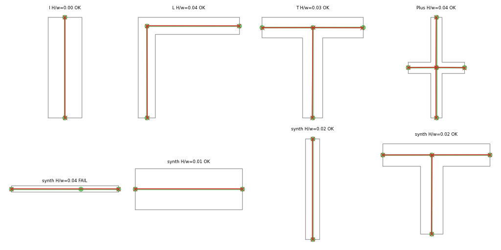
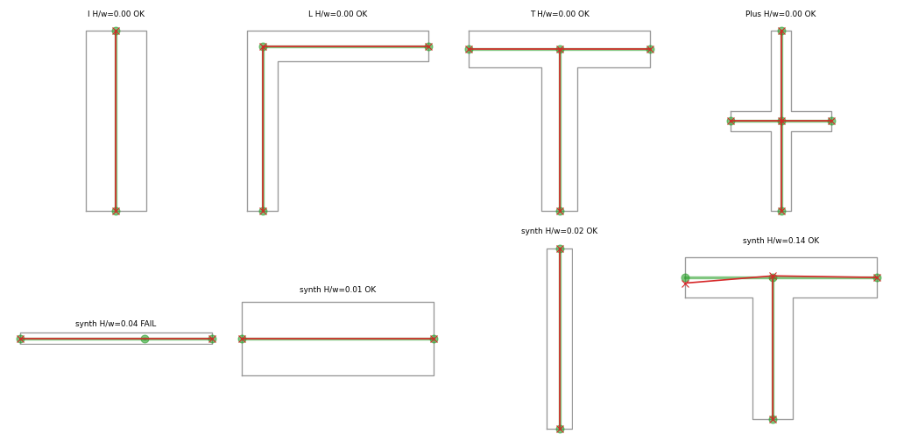

## Graph track results (geometry_based), 2026-11-01, updated 2026-11-02

UPDATE 2026-11-02 (read this first): a larger run finished: `set_transformer__iid__e100` (20000 training
samples, 100 epochs, CPU 2 threads, about 33 s/epoch). On the 1000-sample synthetic test: k_exact 0.905,
deg-seq 0.904, Hausdorff <= 0.25w rate 0.981, ok_025w 0.893, edge F1 0.934 (mean), every predicted graph
connected and a tree. P3 still FAILS, on `k_exact` only (0.905 against the 0.95 bar; deg-seq and the Hausdorff rate now
pass). The 4x larger budget gained only about 0.01 in `k_exact` over the 80-epoch run (0.895), so the
shortfall looks like a model/representation limit, not simple under-training. Real shapes (P4), as reported by
the graph agent and not re-read by me: all four ok, Hausdorff/w I 0.007, L 0.016, T 0.020, Plus 0.023.
Deg-4 subset (n=65): k_exact 0.846, Hausdorff rate 1.0.

NOT finished at close: `ood_deg4` at 100 epochs (was at epoch 57 of 100; P5 evidence is still the weak 30-epoch
run), seeds 1 and 2, `ood_size`, and the four `loso_real` negative-control folds (implemented and smoke-tested,
not run). Resume with `--resume`; commands in `src/geometry_based/README.md`. Test counts for this session were
not recorded (only the 2 new tests were run and passed). The sections below are the 2026-11-01 text and
remain accurate except where this paragraph supersedes them.

Scope: the new template in `src/geometry_based/` (old code now at `methods/graph_transformer/`, `methods/finetuned_graph_transformer/`, `methods/gnn_encoder_decoder/`; `data/raw` untouched). The model learns the midcurve NODE SET only (12 query slots, existence flag, Hungarian loss); edges come from an inside-polygon MST. No shapely, no PyG.

## What was built

All under `src/geometry_based/` (layout of 2026-11-03: shared code in `common/`, one folder per method in `methods/`):

- `run.py`: the one driver (`prepare | train | eval | baseline`).
- `common/prepare_data.py`: raw to `data/dataset_v1.json` (4 gold graphs: profile ring incl. closing edge, midcurve nodes + edges from `.edges`, split roles from `splits.json`), plus the procedural generator (lattice tree, union of flat-capped boxes, regenerated from a seed; only a 20-sample preview `data/synthetic_sample_v1.json` is written).
- `common/geom.py`: point-in-polygon, segment-inside-polygon, union of axis-aligned boxes by grid-cell tracing, normalize, densify, `edges_from_nodes` (scipy MST), snapping.
- `common/dataset.py`, `common/losses.py` (Hungarian set loss), `common/evaluate.py` (metric set), `methods/__init__.py` (REGISTRY, `build_model(cfg)`), `methods/classical_voronoi/model.py` (Voronoi baseline), `methods/set_transformer/model.py` (206,659 parameters).
- `tests/test_graph_track.py` (18 tests).
- Runs: `methods/<method>/runs/<split>__<tag>/{metrics.json, grid.png, log.csv, best.pt, args.json}` (were `runs/<model>__<split>__<tag>/`; run names in the tables below keep the old form).

## Commands

Run from `src/geometry_based`, env `genai`, via `conda run -n genai python ...`:

```
run.py prepare
run.py baseline --model classical --split iid --tag t1
run.py baseline --model classical --split ood_deg4 --tag t1
run.py train --model set_transformer --split iid --tag e80 --epochs 80 --n-train 8000 --n-val 1000 --threads 4
run.py train --model set_transformer --split ood_deg4 --tag e30 --epochs 30 --n-train 8000 --n-val 1000 --threads 4
python -m pytest tests -q
```

## P1-P5 table

| ID | Criterion | Result | Number |
|---|---|---|---|
| P1 | MST on GT nodes reproduces GT edges | PASS | 4/4 real shapes, 2000/2000 synthetic (seed 0) and 600/600 in the test (seed 7) |
| P2 | Generator reproduces I, L, T, Plus `.dat` exactly | PASS | max coordinate difference < 1e-9, vertex counts 4, 6, 8, 12 |
| P3 | iid synthetic: k_exact >= 0.95, deg-seq >= 0.90, Hausdorff <= 0.25w for >= 90% | FAIL (close) | k_exact 0.895, deg-seq 0.891, H<=0.25w 0.947, ok_025w 0.865 (n=1000, 80 epochs) |
| P4 | Real 4 shapes: right nodes, topology, H <= 0.25w | PASS | all four ok; Hausdorff/w: I 0.001, L 0.037, T 0.034, Plus 0.035 |
| P5 | Trained without degree-4 nodes, real Plus still 5 nodes / 4 edges | PASS | Plus: 5 nodes, 4 edges, H/w 0.055 (30-epoch run) |

Raw-unit errors on the real shapes (80-epoch iid model): chamfer_raw I 0.001, L 0.092, T 0.078, Plus 0.092; hausdorff_raw 0.003, 0.187, 0.170, 0.177 (shapes are 5 wide, so these are 1-4% of the wall width).

Other numbers (synthetic test sets, n=1000 unless noted):

| Model / run | k_exact | deg-seq | H<=0.25w | ok_025w | edge F1 |
|---|---|---|---|---|---|
| classical, iid | 0.816 | 0.813 | 0.974 | 0.813 | 0.901 |
| set_transformer iid, 30 epochs | 0.819 | 0.813 | 0.809 | 0.713 | 0.826 |
| set_transformer iid, 80 epochs | 0.895 | 0.891 | 0.947 | 0.865 | 0.919 |
| set_transformer iid, 80 ep, deg-4 subset (n=65) | 0.815 | 0.815 | 0.969 | 0.800 | 0.922 |
| classical, deg-4-only test (n=1000) | 0.763 | 0.751 | 0.915 | 0.751 | 0.922 |
| set_transformer ood_deg4 (30 ep), in-distribution test | 0.837 | 0.829 | 0.795 | 0.714 | 0.814 |
| set_transformer ood_deg4 (30 ep), deg-4-only test (OOD) | 0.242 | 0.217 | 0.545 | 0.155 | 0.525 |

## Classical floor

The Voronoi baseline (not tuned) is exact on all four real shapes (Hausdorff 0). On synthetic iid it gets ok_025w 0.813; its failures are node-count errors (k_exact 0.816), while geometry is good (H<=0.25w for 97.4%). The 80-epoch network beats it on ok_025w (0.865 vs 0.813) and on k_exact (0.895 vs 0.816), but not on the Hausdorff-only rate (0.947 vs 0.974). The classical baseline is therefore a strong floor, as the proposal's caveat predicted: for clean thin rectilinear shapes a rule already works.



*Image file: ../geometry_based/methods/set_transformer/runs/iid__e80/grid.png*



*Image file: ../geometry_based/methods/classical_voronoi/runs/iid__t1/grid.png*

## Feasibility verdict (variable-size graph-to-graph)

Feasible in the node-set plus derived-edges form. Evidence: topology is exactly derivable (P1, P2 pass), the learned node set gives correct graphs on all four real shapes that were never trained on (P4), and a model that never saw a degree-4 node produced the correct Plus (P5). It is not yet at the proposal's P3 bar on the iid synthetic set; validation ok_025w was still rising at the end (0.70 at epoch 20, 0.83 at epoch 80) and the loss was still falling, so this looks like under-training, not a ceiling. Learned adjacency (rung 2b) was not needed so far, because the MST edges were never the cause of failure in these runs (oracle P1 is 100%).

Important nuance on P5: the real Plus passes, but on the synthetic degree-4-only test set the ood_deg4 model collapses (k_exact 0.242, ok_025w 0.155). So the real-Plus success is partly because Plus is a clean, symmetric, 5-node cross that is easy; it should not be read as general extrapolation to unseen degree.

## Honest caveats

- Training budget was cut because the CPU was shared with the other tracks' jobs (epochs took 20 to 90 s): 8000 training samples, 80 epochs (iid) and 30 epochs (ood_deg4), instead of the planned 20000 and 100. P3 is not met at this budget; no longer training was tried beyond 30 to 80 epochs, so I do not claim it would pass.
- The `ood_deg4` run is the 30-epoch one. An 80-epoch rerun was started and was stopped by the system for low memory; I did not restart it. So the P5 and OOD numbers come from the weaker budget.
- A first 100-epoch, 20000-sample iid run (`methods/set_transformer/runs/iid__t1`) was started before I measured speed. I could not stop it (kill denied). It may still be running or may have died; its `metrics.json` exists only if it finished. Not used in any number above.
- Real-shape tests are 4 samples, all width 5 and axis aligned; real P4 passes are weak evidence statistically. Single seed everywhere.
- Synthetic ground truth and the classical algorithm both assume thin rectilinear flat-capped shapes. Curved, noisy, non-orthogonal or hole-containing profiles are out of scope (the `PhDdata` shapes).
- Edge post-processing snaps predicted nodes into the polygon and forces a connected tree (`force_connected`), so predicted graphs are always trees; failures show up as wrong node count or position, not as disconnected graphs.
- The negative control (train on 3 real shapes, test the 4th) and the `ood_size` split were not run (`ood_size` is implemented).
- Chamfer is defined as the mean of the two directed mean nearest distances (not squared), edge-sampled at 0.01 times the bbox half-extent.

## What is left

- Longer or larger training (20000 samples, 100+ epochs, maybe d=128) until P3 passes or plateaus; rerun `ood_deg4` at the same budget; a few seeds.
- Run `ood_size` and the 3-shape negative control.
- Rung 2b (learned adjacency head) only if the MST is shown to fail; rung 2c/2d (noisy, curved profiles, holes) where rules fail and a network might earn its place.
- Docs: `src/geometry_based/README.md` and `analysis_report.md` were not edited.
- Done differently on 2026-11-03: no `_legacy/`; `finetuned_graph_transformer` and `gnn_encoder_decoder` stay under `geometry_based/methods/`, marked retired in their READMEs.

## Test status

New tests (`python -m pytest -q` in `src/geometry_based`; tests/ now also holds the legacy cross-method suite): 33 passed, 2 skipped on 2026-11-03 (20 new + 13 legacy passed, 2 legacy skipped).
